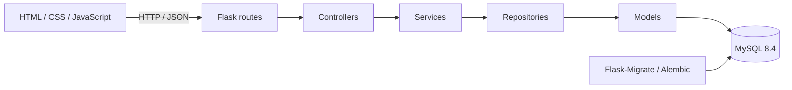

# RIUL — Red de Investigación de la Universidad Libre

Aplicación web académica para explorar semilleros de investigación, administrar
cuentas institucionales y compartir publicaciones. El repositorio contiene un
backend Flask en capas y una interfaz HTML/CSS/JavaScript sin paso de compilación.

## Tecnologías y arquitectura

- Python 3.12, Flask, SQLAlchemy 2, Flask-Migrate/Alembic y Marshmallow.
- MySQL 8.4 como base de datos.
- HTML5, CSS3 y módulos JavaScript nativos.
- Docker Compose para iniciar la base de datos y la aplicación.



El módulo de semilleros tiene persistencia relacional y API de consulta. Los
módulos de proyectos, eventos, logros y reportes aún están en desarrollo y no
deben tratarse como datos persistidos.

## Requisitos

- Docker Desktop con Docker Compose.
- Git para clonar el repositorio.

## Inicio rápido con Docker

Desde la raíz del repositorio:

```powershell
docker compose up --build
```

La aplicación estará en <http://localhost:5000>. MySQL queda disponible en el
puerto `3307` del equipo y usa el puerto `3306` dentro de la red de Compose.
Al primer inicio se aplican las migraciones y se cargan los datos de demostración
si no existen usuarios. Si ya hay usuarios, no se reemplazan las cuentas ni las
publicaciones; se agregan los catálogos y semilleros seed que aún falten, además
de las membresías correspondientes a usuarios seed existentes. Los reinicios
posteriores conservan los datos en el volumen `mysql_data`.

Para detener los servicios sin borrar la base de datos:

```powershell
docker compose down
```

No uses `docker compose down -v` salvo que quieras eliminar también los datos
persistidos. Los valores predeterminados de Compose son únicamente para desarrollo;
antes de publicar o desplegar el sistema, crea un archivo `.env` desde
[`.env.example`](./.env.example) y cambia las contraseñas y llaves.

### Cuentas de demostración

Las cuentas de datos seed usan la contraseña común `RiulDemo2026*` de forma
predeterminada (`DEMO_USERS_PASSWORD` permite cambiarla antes de la primera
siembra).

| Rol / estado | Correo de prueba |
| --- | --- |
| Administrador | `ana.restrepo@unilibre.edu.co` |
| Administrador | `leonardo.pardo@unilibre.edu.co` |
| Líder | `laura.mendoza@unilibre.edu.co` |
| Líder | `maria.antonieta.perez@unilibre.edu.co` |
| Líder | `mateo.silva@unilibre.edu.co` |
| Líder | `javier.torres@unilibre.edu.co` |
| Investigador | `camila.rojas@unilibre.edu.co` |
| Investigador | `andres.perez@unilibre.edu.co` |
| Investigador | `luis.grandett@unilibre.edu.co` |
| Investigador | `carolina.martinez@unilibre.edu.co` |
| Investigador | `diego.gutierrez@unilibre.edu.co` |
| Investigador | `paula.fernandez@unilibre.edu.co` |
| Investigador | `sofia.diaz@unilibre.edu.co` |
| Solicitud pendiente | `isabela.blanco@gmail.com` |
| Cuenta rechazada | `tomas.restrepo@hotmail.com` |

Las cuentas pendiente y rechazada no pueden iniciar sesión. Estas credenciales
son datos públicos de demostración: no las reutilices ni las configures en un
entorno real.

## Pruebas

Las pruebas requieren una instancia MySQL local accesible en `localhost:3307`.
Con la base de datos de Compose en ejecución, instala el grupo de desarrollo
desde `backend` y ejecuta pytest:

```powershell
Set-Location backend
uv sync --frozen --group dev
uv run pytest
```

La configuración de pruebas usa `TEST_DATABASE_URL` y `MYSQL_ADMIN_URL` para
crear y limpiar una base de datos separada llamada `riul_test`; configura esas
variables en `.env` si tus credenciales locales difieren. No apuntes
`TEST_DATABASE_URL` a una base de datos con información que quieras conservar.

## API y migraciones

- Especificación OpenAPI: <http://localhost:5000/docs.html> (sirve
  `backend/app/static/openapi.yaml`).
- Semilleros: `GET /api/semilleros` y `GET /api/semilleros/{id-o-slug}`.
- Autenticación y catálogo: `/api/auth`.
- Publicaciones: `/api/posts`.
- Administración: `/api/admin` (requiere rol administrador).

Las migraciones se ejecutan automáticamente en el arranque del contenedor. Para
aplicarlas manualmente dentro de la aplicación:

```powershell
docker compose exec app flask db upgrade
```

`flask seed-demo` reconstruye el conjunto de demostración y elimina los datos
de usuarios/publicaciones actuales; úsalo solo en una base descartable. El
arranque automático emplea `flask seed-demo --if-empty` y no reemplaza datos
existentes.
