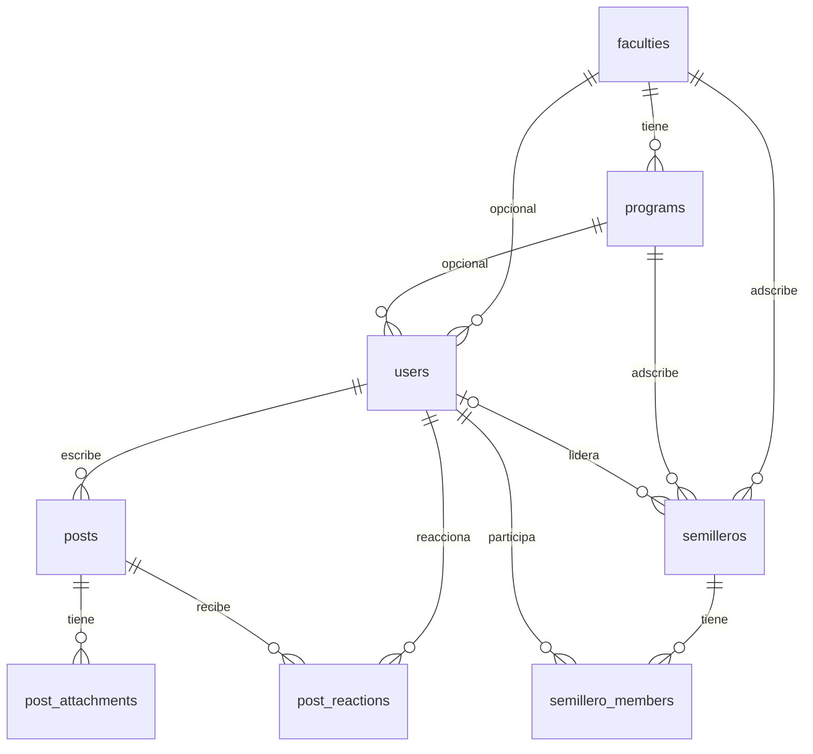

# RIUL — Auditoría y alineación con la rúbrica (segundo corte)

Rama de trabajo: `rubrica-segundo-corte`. Fecha: 2026-10-18.

Este documento es el entregable de auditoría: estado encontrado, correcciones
aplicadas (sin rehacer el sistema, sin operaciones destructivas de datos),
evidencia de ejecución y evaluación honesta por criterio. No afirma una nota
perfecta: indica brechas reales y pendientes.

## 1. Resumen ejecutivo

La aplicación ya tenía una base sólida (Flask en capas, MySQL 8.4, Docker
Compose, JS sin build, suite de pruebas verde). La auditoría encontró cinco
brechas medibles y se corrigieron todas de forma incremental:

1. **Integridad de datos**: no había restricciones `CHECK` a nivel de base de
   datos ni reglas `ON DELETE` en las claves foráneas (solo lógica de aplicación
   y cascadas del ORM).
2. **Coherencia de navegación**: el panel administrativo marcaba "Semilleros"
   como *no disponible* aunque sí está implementado; había anclas muertas.
3. **Violaciones de la constitución (arquitectura)**: un controlador importaba
   un repositorio y el servicio de seed consultaba el ORM directamente.
4. **Higiene**: repositorio de catálogo con API ORM legacy y dos `alembic.ini`
   duplicados.
5. **Transparencia**: vistas no persistidas (proyectos, eventos, gamificación)
   no estaban rotuladas como datos de demostración.

## 2. Método

- Se inspeccionó el repositorio completo (código, migraciones, plantillas,
  estáticos, especificaciones, documentación, Compose).
- Se verificó ejecutando el sistema real: build de Docker Compose en WSL,
  arranque con migraciones + seed, consultas a `information_schema` y llamadas
  HTTP a la API; y la suite `pytest` contra MySQL.
- Cada hallazgo se clasifica con evidencia `archivo:línea` y se contrastó con
  la constitución del proyecto (`.specify/memory/constitution.md`).

## 3. Matriz de auditoría por criterio

| Criterio | Estado inicial | Estado final tras correcciones |
| --- | --- | --- |
| **C1 Diseño BD (1.50)** | Bueno: 3FN, PK/FK, únicos y migraciones `0001`/`0002`; **sin CHECK ni reglas ON DELETE**. | Excelente: se añade migración `0003` con 4 `CHECK` y `ON DELETE` en las 12 FKs, aplicada y verificada. |
| **C2 HTML/CSS (1.50)** | Bueno: design system con tokens, 17 plantillas, responsive. | Mejora: navegación admin coherente; vistas demo rotuladas. |
| **C3 Estructura (0.75)** | Bueno con violaciones constitucionales (controlador→repositorio; seed→ORM directo; ORM legacy; doble `alembic.ini`). | Corregido: dependencia de una sola vía y un único `alembic.ini` efectivo. |
| **C4 Docker (0.75)** | Bueno: Compose con `db`+`app`, healthcheck y volúmenes; faltaba política de reinicio de `app`. | Mejorado: `restart: unless-stopped` en `app`; arranque reproducible verificado. |
| **C5 Coherencia (0.50)** | Bueno: OpenAPI alinea con rutas; docs. Incoherencias: nav admin y módulos demo sin rotular. | Mejorado: nav coherente, demo rotulado, ER/docs de datos actualizados con `0003`. |

## 4. Cambios implementados

### P0 — Coherencia (C5/C2)

- `backend/app/templates/admin.html`: "Semilleros" deja de ser `unavailable` y
  apunta a la sección real (`#catalogs`); se eliminan anclas sin destino.
- `backend/app/static/js/admin.js`: se exponen `id="overview"` y `id="catalogs"`
  para que la navegación del panel tenga destinos reales.
- `backend/app/templates/{dashboard,profile,projects,events}.html` +
  `backend/app/static/css/design-system.css`: banda visible "Datos de
  demostración" en las vistas no persistidas.

### P1 — Base de datos (C1)

- `backend/migrations/versions/0003_add_check_constraints.py` (nueva):
  - `CHECK`: `ck_users_role`, `ck_users_status`, `ck_posts_category`,
    `ck_post_attachments_kind`.
  - `ON DELETE`: `CASCADE` en dependientes (`programs.faculty_id`,
    `posts.author_id`, `post_attachments.post_id`, `post_reactions.*`,
    `semillero_members.*`) y `SET NULL` en referencias opcionales
    (`users.faculty_id/program_id`, `semilleros.faculty_id/program_id/leader_id`).
  - No destructiva: recrea claves foráneas y añade checks; no borra datos.
- Modelos alineados con el esquema real: `backend/app/models/{user,post,semillero}.py`.
- Documentación alineada: `docs/tablas-y-datos.md`, `docs/er-riul.md`.

### P2 — Arquitectura (C3)

- `backend/app/controllers/admin_controller.py`: el guard reutiliza
  `auth_service.get_identity` (ya no importa `user_repository`).
- `backend/app/services/seed_service.py`: todo el acceso se hace por
  repositorios (fin de `Model.query` y de `db.session` directo).
- Nuevos/actualizados: `backend/app/repositories/seed_repository.py`,
  `catalog_repository.py` (`count_*`, `flush`, `commit`, `select()`),
  `post_repository.py` (`count_all_reactions`), `semillero_repository.py`
  (`get_member`, `flush`), `user_repository.py` (se retiran conteos de catálogo),
  `services/admin_service.py` (usa `catalog_repository`).

### P3 — Higiene (C3)

- `backend/alembic.ini` (raíz) eliminado: Flask-Migrate usa
  `Config(os.path.join('migrations', 'alembic.ini'))`, es decir
  `backend/migrations/alembic.ini` (única fuente efectiva).
- `backend/dockerfile`: ya no copia el `alembic.ini` redundante.
- `backend/tests/test_semilleros.py`: `Query.get()` → `db.session.get()`.
- `backend/tests/test_admin.py`: estado de prueba `suspended` (inválido) →
  `rejected` (válido), coherente con la nueva restricción `CHECK`.

### P4 — Verificación y documentación

- `compose.yml`: `restart: unless-stopped` en el servicio `app`.
- Este informe; la ejecución Docker está en `README.md` (sección "Inicio rápido
  con Docker") y el ER actualizado en `docs/er-riul.md`.

## 5. Matriz de trazabilidad (requerimiento → BD → backend → UI → validación)

| Requerimiento | Base de datos | Backend | UI | Validación |
| --- | --- | --- | --- | --- |
| Autenticación institucional y solicitudes | `users` (role/status con CHECK) | `routes/auth.py` → `auth_controller` → `auth_service` → `user_repository` | `login.html`, `register.html`, `js/auth.js` | `test_auth.py`; login 200/401/403 en vivo |
| Feed de publicaciones | `posts`, `post_attachments`, `post_reactions` (CHECK+FK) | `routes/posts.py` → `post_service` → `post_repository` | `feed.html`, `js/feed.js` | `test_posts.py` |
| Catálogo académico | `faculties`, `programs` | `auth_service.catalog` → `catalog_repository` | selects en `register.html` | `test_auth.py`; `/api/auth/catalog` |
| Semilleros | `semilleros`, `semillero_members` (única + FKs) | `routes/semilleros.py` → `semillero_service` → `semillero_repository` | `semilleros.html`, `semillero-detalle.html`, `js/semilleros*.js` | `test_semilleros.py`; `/api/semilleros` 4 items |
| Administración de usuarios | `users` | `admin_controller` (`require_administrator`→`auth_service`) → `admin_service` → repos | `admin.html`, `js/admin.js` | `test_admin.py`; overview/`401`/`403`/`400` en vivo |
| Proyectos/Eventos/Gamificación/Reportes (no persistidos) | — (no hay tabla) | se exponen como `unavailable` en `admin_service.overview` | vistas demo rotuladas (`demo-banner`) | documentado; sin datos falsos presentados como reales |

## 6. Diagrama entidad-relación (actualizado)

Diagrama completo, con `ON DELETE` y `CHECK` documentados, en
[`docs/er-riul.md`](er-riul.md). Núcleo implementado:



`users.role`/`users.status`, `posts.category` y `post_attachments.kind` se
validan con `CHECK` (migración `0003`).

## 7. Evidencia de ejecución

### Docker Compose (WSL, Docker 29.7.2)

```
docker compose up -d --build
```

- Build de la imagen `riul-aplicativo-app` correcto.
- Log del arranque:
  `Running upgrade 0002 -> 0003, Add database-level CHECK constraints and ON DELETE rules.`
  y luego `Starting gunicorn ... Listening at: http://0.0.0.0:5000`.

### Restricciones en MySQL

- `information_schema.CHECK_CONSTRAINTS` muestra las 4 restricciones.
- `information_schema.REFERENTIAL_CONSTRAINTS` muestra `CASCADE`/`SET NULL` en
  las 12 claves foráneas.
- Insertar `status='suspended'` falla:
  `ERROR 3819 (HY000): Check constraint 'ck_users_status' is violated.`
- Conteos: 15 usuarios, 15 posts, 47 reacciones, 4 semilleros, 7 miembros.

### API y páginas (HTTP)

- `GET /`, `/login`, `/register`, `/docs` → `200`.
- `GET /api/semilleros` → `200`, 4 items.
- Login admin (`ana.restrepo@unilibre.edu.co`) → token; `GET /api/admin/overview`
  → conteos reales y `semilleros` **fuera** de `unavailable`.
- Sin token → `401`; contraseña inválida → `401`; `PATCH` con estado inválido → `400`.
- `dashboard`, `projects`, `events`, `profile` incluyen la banda de demostración;
  el panel admin ya no marca "Semilleros" como no disponible.

### Pruebas automatizadas

```
cd backend && pytest
# 58 passed
```

## 8. Evaluación final por criterio

| Criterio | Peso | Evaluación | Sustento | Riesgo residual |
| --- | --- | --- | --- | --- |
| C1 Diseño BD | 1.50 | Muy alto (~1.40–1.50) | 8 tablas 3FN, PK/FK, únicos, CHECK y ON DELETE verificados en MySQL. | `ER` se mantiene como documento; el `.drawio` se edita a mano. |
| C2 HTML/CSS | 1.50 | Alto (~1.30–1.45) | Design system con tokens, responsive, vistas demo rotuladas; fidelidad al mockup de semilleros. | Algunos botones (`disabled`) sin acción y módulos demo no persistidos. |
| C3 Estructura | 0.75 | Muy alto (~0.70–0.75) | Capas `routes→controllers→services→repositories→models` sin violaciones conocidas; un solo `alembic.ini`. | — |
| C4 Docker | 0.75 | Muy alto (~0.70–0.75) | Compose reproducible verificado (migraciones + seed + gunicorn), `restart` en `app`. | Secretos por defecto son solo para desarrollo (documentado). |
| C5 Coherencia | 0.50 | Alto (~0.40–0.50) | OpenAPI ↔ rutas ↔ UI; nav admin coherente; docs alineados. | La portada pública enlaza a páginas del área autenticada (redirige a login). |

## 9. Pendientes y bloqueos (honestos)

- **Portada pública vs. área autenticada**: `index.html` ofrece acceso a
  Semilleros/Proyectos/Eventos, que requieren sesión. Es una decisión de
  producto (¿consulta pública o gated?). Se deja documentado, no se alteró sin
  definición del equipo.
- **Módulos no persistidos** (proyectos, eventos, gamificación, reportes) siguen
  como demostración rotulada; requieren tablas, migración y API para considerarse
  terminados.
- **Entorno**: la verificación Docker depende de que el motor de Docker en WSL
  esté estable; entre comandos el VM puede suspenderse. Los resultados anteriores
  corresponden a ejecuciones con el stack arriba.
- **Git**: los cambios quedan sin commitear en `rubrica-segundo-corte`; según la
  constitución, commit/push los ejecuta una persona del equipo.
