# RIUL — esquema entidad-relación completo

Fuente de verdad: los modelos SQLAlchemy de [`backend/app/models/`](../backend/app/models/) y las migraciones
[`0001`](../backend/migrations/versions/0001_initial_mysql_tables.py),
[`0002`](../backend/migrations/versions/0002_research_domain.py),
[`0003`](../backend/migrations/versions/0003_support_tickets.py) y
[`0004_complete_data_model.py`](../backend/migrations/versions/0004_complete_data_model.py) (modelo completo del diagrama ER).
Motor: MySQL 8.4 (las `CHECK` se aplican). **34 tablas** en 8 dominios, más la tabla de archivo
`achievements_legacy` (logros históricos sin origen verificable, creada por la migración 0004).

Diagrama en Draw.io: [`docs/er-riul.drawio`](er-riul.drawio) (abrir en [app.diagrams.net](https://app.diagrams.net/) o con la extensión Draw.io de VS Code / Cursor).
Descripción columna a columna y datos sembrados: [`tablas-y-datos.md`](tablas-y-datos.md).

## Reglas de negocio que el esquema garantiza

- **Un logro nace de exactamente un origen** (`event_id`, `post_id`, `project_id`, `product_id` o `semillero_id`): `CHECK` en `achievements` (la suma de columnas de origen no nulas debe ser 1). El tipo (`achievement_types`) se deduce del origen.
- **El XP es un libro mayor**: aprobar un logro inserta una fila en `xp_ledger` (única por logro); `user_progress`, `semillero_progress` y `user_badges` se derivan de él. El nivel sale de `levels` (umbral de XP acumulado).
- **Vinculación a semilleros con aprobación**: `semillero_members.status` = `pending` → `active` | `rejected`; el líder (`semilleros.leader_id`) siempre es miembro activo con rol `leader`.
- **Eventos y convocatorias son entidades separadas** (`events` / `calls`) con participaciones (`event_participations`) y postulaciones (`call_applications`, de una persona **o** de un semillero: `CHECK` de un solo postulante).
- **Reportes** (`report_snapshots`): instantánea JSON de métricas de un periodo; solo los publicados (`published_at`) son visibles para todos.

## Leyenda de dominios

| Dominio | Color | Tablas |
| --- | --- | --- |
| 1 Identidad y acceso | `#7B001F` | `users`, `user_profiles` |
| 2 Catálogo académico | `#2563EB` | `faculties`, `programs` |
| 3 Feed / publicaciones | `#0F766E` | `posts`, `post_attachments`, `post_reactions`, `comments`, `post_shares` |
| 4 Semilleros | `#7C3AED` | `semilleros`, `semillero_members`, `semillero_research_lines`, `semillero_activities`, `semillero_follows`, `semillero_progress` |
| 5 Proyectos y productos | `#15803D` | `projects`, `project_members`, `project_milestones`, `products` |
| 6 Eventos y convocatorias | `#D97706` | `events`, `event_participations`, `calls`, `call_applications` |
| 7 Gamificación | `#EA580C` | `levels`, `badges`, `achievement_types`, `achievements`, `evidences`, `xp_ledger`, `user_progress`, `user_badges` |
| 8 Notificaciones, soporte y reportes | `#64748B` | `notifications`, `support_tickets`, `report_snapshots` |

## Diagrama Mermaid

```mermaid
erDiagram
  achievement_types ||--o{ achievements : type_id
  achievements ||--o{ evidences : achievement_id
  achievements ||--o{ user_badges : achievement_id
  achievements ||--o{ xp_ledger : achievement_id
  badges |o--o{ achievement_types : badge_id
  badges ||--o{ user_badges : badge_id
  calls ||--o{ call_applications : call_id
  events |o--o{ achievements : event_id
  events ||--o{ event_participations : event_id
  faculties |o--o{ users : faculty_id
  faculties ||--o{ programs : faculty_id
  faculties ||--o{ semilleros : faculty_id
  levels ||--o{ semillero_progress : level_id
  levels ||--o{ user_progress : level_id
  posts |o--o{ achievements : post_id
  posts ||--o{ comments : post_id
  posts ||--o{ post_attachments : post_id
  posts ||--o{ post_reactions : post_id
  posts ||--o{ post_shares : post_id
  products |o--o{ achievements : product_id
  programs |o--o{ semilleros : program_id
  programs |o--o{ users : program_id
  projects |o--o{ achievements : project_id
  projects |o--o{ products : project_id
  projects ||--o{ project_members : project_id
  projects ||--o{ project_milestones : project_id
  semilleros |o--o{ achievements : semillero_id
  semilleros |o--o{ achievements : xp_semillero_id
  semilleros |o--o{ call_applications : semillero_id
  semilleros |o--o{ events : semillero_id
  semilleros |o--o{ products : semillero_id
  semilleros |o--o{ projects : semillero_id
  semilleros ||--o{ semillero_activities : semillero_id
  semilleros ||--o{ semillero_follows : semillero_id
  semilleros ||--o{ semillero_members : semillero_id
  semilleros ||--o{ semillero_progress : semillero_id
  semilleros ||--o{ semillero_research_lines : semillero_id
  users |o--o{ achievements : validated_by
  users |o--o{ call_applications : user_id
  users |o--o{ events : created_by
  users |o--o{ semillero_members : approved_by
  users ||--o{ achievements : user_id
  users ||--o{ calls : published_by
  users ||--o{ comments : user_id
  users ||--o{ event_participations : user_id
  users ||--o{ notifications : user_id
  users ||--o{ post_reactions : user_id
  users ||--o{ post_shares : user_id
  users ||--o{ posts : user_id
  users ||--o{ products : user_id
  users ||--o{ project_members : user_id
  users ||--o{ report_snapshots : generated_by
  users ||--o{ semillero_follows : user_id
  users ||--o{ semillero_members : user_id
  users ||--o{ semilleros : leader_id
  users ||--o{ support_tickets : user_id
  users ||--o{ user_badges : user_id
  users ||--o{ user_profiles : user_id
  users ||--o{ user_progress : user_id
  users ||--o{ xp_ledger : user_id
  badges {
    int id PK
    varchar name UK
    varchar description
    varchar icon
  }
  faculties {
    int id PK
    varchar name UK
  }
  levels {
    int id PK
    int level_number UK
    int min_xp
    int stars
  }
  achievement_types {
    int id PK
    varchar code UK
    varchar name
    varchar icon
    int xp_value
    int badge_id FK
  }
  programs {
    int id PK
    varchar name
    int faculty_id FK
  }
  users {
    int id PK
    varchar full_name
    varchar email UK
    varchar password_hash
    varchar role
    varchar status
    varchar motivation
    int faculty_id FK
    int program_id FK
    datetime created_at
  }
  calls {
    int id PK
    varchar slug UK
    varchar title
    text description
    varchar type
    varchar status
    datetime starts_at
    datetime ends_at
    varchar location
    varchar organizer
    json requirements
    int published_by FK
    datetime created_at
  }
  notifications {
    int id PK
    int user_id FK
    varchar type
    varchar entity_kind
    int entity_id
    varchar title
    varchar text
    varchar priority
    varchar href
    datetime read_at
    datetime created_at
  }
  posts {
    int id PK
    int user_id FK
    varchar category
    text content
    varchar link_url
    datetime created_at
  }
  report_snapshots {
    int id PK
    int generated_by FK
    varchar kind
    date period_start
    date period_end
    datetime published_at
    json metrics_json
    datetime created_at
  }
  semilleros {
    int id PK
    varchar slug UK
    varchar name
    varchar area
    text description
    varchar icon
    varchar top_badge
    int faculty_id FK
    int program_id FK
    int leader_id FK
    varchar leader_title
    varchar affiliation
    text about
    text mission
    text vision
    json interest_areas
    datetime created_at
  }
  support_tickets {
    int id PK
    int user_id FK
    varchar category
    varchar subject
    text message
    varchar status
    text admin_reply
    datetime replied_at
    datetime created_at
  }
  user_profiles {
    int id PK
    int user_id FK
    text bio
    varchar photo
    varchar orcid
  }
  user_progress {
    int id PK
    int user_id FK
    int xp
    int level_id FK
    int stars
  }
  call_applications {
    int id PK
    int call_id FK
    int user_id FK
    int semillero_id FK
    varchar status
    datetime created_at
  }
  comments {
    int id PK
    int post_id FK
    int user_id FK
    text body
    datetime created_at
  }
  events {
    int id PK
    varchar slug UK
    varchar title
    text description
    varchar type
    varchar status
    datetime starts_at
    datetime ends_at
    varchar location
    int capacity
    varchar organizer
    json requirements
    int semillero_id FK
    int created_by FK
    datetime created_at
  }
  post_attachments {
    int id PK
    int post_id FK
    varchar kind
    varchar file_name
    varchar storage_name UK
    varchar mime_type
    int file_size
  }
  post_reactions {
    int id PK
    int post_id FK
    int user_id FK
    datetime created_at
  }
  post_shares {
    int id PK
    int post_id FK
    int user_id FK
    datetime created_at
  }
  projects {
    int id PK
    varchar slug UK
    varchar title
    varchar type
    varchar status
    text description
    int progress
    varchar line
    varchar role_required
    date start_date
    date end_date
    int semillero_id FK
    datetime created_at
  }
  semillero_activities {
    int id PK
    int semillero_id FK
    varchar title
    varchar place
    date occurred_on
  }
  semillero_follows {
    int id PK
    int semillero_id FK
    int user_id FK
    datetime created_at
  }
  semillero_members {
    int id PK
    int semillero_id FK
    int user_id FK
    varchar role
    varchar status
    int approved_by FK
    datetime joined_at
  }
  semillero_progress {
    int id PK
    int semillero_id FK
    int level_id FK
    int xp
  }
  semillero_research_lines {
    int id PK
    int semillero_id FK
    varchar name
    varchar icon
    varchar coordinator
  }
  event_participations {
    int id PK
    int event_id FK
    int user_id FK
    varchar role
    varchar status
    datetime created_at
  }
  products {
    int id PK
    int user_id FK
    int project_id FK
    int semillero_id FK
    varchar type
    varchar title
    varchar venue
    date published_on
    varchar status
    datetime created_at
  }
  project_members {
    int id PK
    int project_id FK
    int user_id FK
    varchar role
  }
  project_milestones {
    int id PK
    int project_id FK
    varchar title
    boolean done
    int position
  }
  achievements {
    int id PK
    int user_id FK
    int type_id FK
    varchar status
    int validated_by FK
    datetime validated_at
    int event_id FK
    int post_id FK
    int project_id FK
    int product_id FK
    int semillero_id FK
    int xp_semillero_id FK
    varchar title
    text description
    date achieved_on
    datetime created_at
  }
  evidences {
    int id PK
    int achievement_id FK
    varchar file_name
    varchar storage_name UK
    varchar mime_type
    int file_size
    datetime created_at
  }
  user_badges {
    int id PK
    int user_id FK
    int badge_id FK
    int achievement_id FK
    datetime created_at
  }
  xp_ledger {
    int id PK
    int user_id FK
    int achievement_id FK
    int amount
    datetime created_at
  }
```



## Claves foráneas

| Tabla | Columna | Referencia |
| --- | --- | --- |
| `achievement_types` | `badge_id` NULL | `badges.id` |
| `programs` | `faculty_id` NOT NULL | `faculties.id` |
| `users` | `faculty_id` NULL | `faculties.id` |
| `users` | `program_id` NULL | `programs.id` |
| `calls` | `published_by` NOT NULL | `users.id` |
| `notifications` | `user_id` NOT NULL | `users.id` |
| `posts` | `user_id` NOT NULL | `users.id` |
| `report_snapshots` | `generated_by` NOT NULL | `users.id` |
| `semilleros` | `faculty_id` NOT NULL | `faculties.id` |
| `semilleros` | `program_id` NULL | `programs.id` |
| `semilleros` | `leader_id` NOT NULL | `users.id` |
| `support_tickets` | `user_id` NOT NULL | `users.id` |
| `user_profiles` | `user_id` NOT NULL | `users.id` · ON DELETE CASCADE |
| `user_progress` | `user_id` NOT NULL | `users.id` |
| `user_progress` | `level_id` NOT NULL | `levels.id` |
| `call_applications` | `call_id` NOT NULL | `calls.id` |
| `call_applications` | `user_id` NULL | `users.id` |
| `call_applications` | `semillero_id` NULL | `semilleros.id` |
| `comments` | `post_id` NOT NULL | `posts.id` · ON DELETE CASCADE |
| `comments` | `user_id` NOT NULL | `users.id` |
| `events` | `semillero_id` NULL | `semilleros.id` |
| `events` | `created_by` NULL | `users.id` |
| `post_attachments` | `post_id` NOT NULL | `posts.id` |
| `post_reactions` | `post_id` NOT NULL | `posts.id` |
| `post_reactions` | `user_id` NOT NULL | `users.id` |
| `post_shares` | `post_id` NOT NULL | `posts.id` · ON DELETE CASCADE |
| `post_shares` | `user_id` NOT NULL | `users.id` |
| `projects` | `semillero_id` NULL | `semilleros.id` |
| `semillero_activities` | `semillero_id` NOT NULL | `semilleros.id` |
| `semillero_follows` | `semillero_id` NOT NULL | `semilleros.id` |
| `semillero_follows` | `user_id` NOT NULL | `users.id` |
| `semillero_members` | `semillero_id` NOT NULL | `semilleros.id` |
| `semillero_members` | `user_id` NOT NULL | `users.id` |
| `semillero_members` | `approved_by` NULL | `users.id` |
| `semillero_progress` | `semillero_id` NOT NULL | `semilleros.id` |
| `semillero_progress` | `level_id` NOT NULL | `levels.id` |
| `semillero_research_lines` | `semillero_id` NOT NULL | `semilleros.id` |
| `event_participations` | `event_id` NOT NULL | `events.id` |
| `event_participations` | `user_id` NOT NULL | `users.id` |
| `products` | `user_id` NOT NULL | `users.id` |
| `products` | `project_id` NULL | `projects.id` |
| `products` | `semillero_id` NULL | `semilleros.id` |
| `project_members` | `project_id` NOT NULL | `projects.id` |
| `project_members` | `user_id` NOT NULL | `users.id` |
| `project_milestones` | `project_id` NOT NULL | `projects.id` |
| `achievements` | `user_id` NOT NULL | `users.id` |
| `achievements` | `type_id` NOT NULL | `achievement_types.id` |
| `achievements` | `validated_by` NULL | `users.id` |
| `achievements` | `event_id` NULL | `events.id` |
| `achievements` | `post_id` NULL | `posts.id` |
| `achievements` | `project_id` NULL | `projects.id` |
| `achievements` | `product_id` NULL | `products.id` |
| `achievements` | `semillero_id` NULL | `semilleros.id` |
| `achievements` | `xp_semillero_id` NULL | `semilleros.id` |
| `evidences` | `achievement_id` NOT NULL | `achievements.id` · ON DELETE CASCADE |
| `user_badges` | `user_id` NOT NULL | `users.id` |
| `user_badges` | `badge_id` NOT NULL | `badges.id` |
| `user_badges` | `achievement_id` NOT NULL | `achievements.id` |
| `xp_ledger` | `user_id` NOT NULL | `users.id` |
| `xp_ledger` | `achievement_id` NOT NULL | `achievements.id` |

## Unicidad

| Tabla | Restricción |
| --- | --- |
| `badges` | UNIQUE `(name)` |
| `badges` | UNIQUE `name` |
| `faculties` | UNIQUE `(name)` |
| `faculties` | UNIQUE `name` |
| `levels` | UNIQUE `(level_number)` |
| `levels` | UNIQUE `level_number` |
| `achievement_types` | UNIQUE `(code)` |
| `achievement_types` | UNIQUE `code` |
| `programs` | UNIQUE `(name, faculty_id)` |
| `users` | UNIQUE `email` |
| `calls` | UNIQUE `slug` |
| `semilleros` | UNIQUE `slug` |
| `user_profiles` | UNIQUE `(user_id)` |
| `user_profiles` | UNIQUE `user_id` |
| `user_progress` | UNIQUE `(user_id)` |
| `user_progress` | UNIQUE `user_id` |
| `call_applications` | UNIQUE `(call_id, semillero_id)` |
| `call_applications` | UNIQUE `(call_id, user_id)` |
| `events` | UNIQUE `slug` |
| `post_attachments` | UNIQUE `(storage_name)` |
| `post_attachments` | UNIQUE `storage_name` |
| `post_reactions` | UNIQUE `(post_id, user_id)` |
| `post_shares` | UNIQUE `(post_id, user_id)` |
| `projects` | UNIQUE `slug` |
| `semillero_follows` | UNIQUE `(semillero_id, user_id)` |
| `semillero_members` | UNIQUE `(semillero_id, user_id)` |
| `semillero_progress` | UNIQUE `(semillero_id)` |
| `semillero_progress` | UNIQUE `semillero_id` |
| `event_participations` | UNIQUE `(event_id, user_id)` |
| `project_members` | UNIQUE `(project_id, user_id)` |
| `evidences` | UNIQUE `(storage_name)` |
| `evidences` | UNIQUE `storage_name` |
| `user_badges` | UNIQUE `(user_id, badge_id)` |
| `xp_ledger` | UNIQUE `(achievement_id)` |
| `xp_ledger` | UNIQUE `achievement_id` |

## Restricciones CHECK

| Tabla | Condición |
| --- | --- |
| `levels` | `stars BETWEEN 1 AND 5` |
| `achievement_types` | `code IN ('event','post','project','article','presentation','patent','semillero')` |
| `calls` | `status IN ('open','closed')` |
| `calls` | `ends_at >= starts_at` |
| `report_snapshots` | `period_end >= period_start` |
| `report_snapshots` | `kind IN ('report','ranking')` |
| `support_tickets` | `status IN ('open','in_progress','resolved')` |
| `user_progress` | `stars BETWEEN 1 AND 5` |
| `call_applications` | `status IN ('pending','accepted','rejected')` |
| `call_applications` | `(user_id IS NOT NULL AND semillero_id IS NULL) OR (user_id IS NULL AND semillero_id IS NOT NULL)` |
| `events` | `ends_at >= starts_at` |
| `events` | `status IN ('open','closed')` |
| `projects` | `progress BETWEEN 0 AND 100` |
| `projects` | `status IN ('planned','in_progress','review','closed')` |
| `semillero_members` | `role IN ('leader','co_leader','member')` |
| `semillero_members` | `status IN ('pending','active','rejected')` |
| `event_participations` | `role IN ('attendee','speaker','organizer')` |
| `event_participations` | `status IN ('available','registered','pending','closed')` |
| `products` | `status IN ('in_review','approved')` |
| `products` | `type IN ('article','presentation','patent','report')` |
| `project_members` | `role IN ('principal','member')` |
| `achievements` | `status IN ('pending','approved','rejected')` |
| `achievements` | `(event_id IS NOT NULL) + (post_id IS NOT NULL) + (project_id IS NOT NULL) + (product_id IS NOT NULL) + (semillero_id IS NOT NULL) = 1` |

## DBML

Importable en [dbdiagram.io](https://dbdiagram.io); cada `TableGroup` lleva el color de su dominio.

```dbml
Project riul {
  database_type: 'MySQL'
  Note: 'Esquema completo — migraciones 0001 a 0004 (34 tablas + achievements_legacy)'
}

TableGroup dominio_1 [color: #7B001F] {
  users
  user_profiles
}

TableGroup dominio_2 [color: #2563EB] {
  faculties
  programs
}

TableGroup dominio_3 [color: #0F766E] {
  posts
  post_attachments
  post_reactions
  comments
  post_shares
}

TableGroup dominio_4 [color: #7C3AED] {
  semilleros
  semillero_members
  semillero_research_lines
  semillero_activities
  semillero_follows
  semillero_progress
}

TableGroup dominio_5 [color: #15803D] {
  projects
  project_members
  project_milestones
  products
}

TableGroup dominio_6 [color: #D97706] {
  events
  event_participations
  calls
  call_applications
}

TableGroup dominio_7 [color: #EA580C] {
  levels
  badges
  achievement_types
  achievements
  evidences
  xp_ledger
  user_progress
  user_badges
}

TableGroup dominio_8 [color: #64748B] {
  notifications
  support_tickets
  report_snapshots
}

Table badges {
  id int [pk, increment]
  name varchar(120) [not null, unique]
  description varchar(255)
  icon varchar(40) [not null, default: `military_tech`]
}

Table faculties {
  id int [pk, increment]
  name varchar(120) [not null, unique]
}

Table levels {
  id int [pk, increment]
  level_number int [not null, unique]
  min_xp int [not null]
  stars int [not null]
}

Table achievement_types {
  id int [pk, increment]
  code varchar(20) [not null, unique]
  name varchar(120) [not null]
  icon varchar(40) [not null, default: `military_tech`]
  xp_value int [not null, default: `0`]
  badge_id int
}

Table programs {
  id int [pk, increment]
  name varchar(120) [not null]
  faculty_id int [not null]

  indexes {
    (name, faculty_id) [unique]
  }
}

Table users {
  id int [pk, increment]
  full_name varchar(160)
  email varchar(255) [not null, unique]
  password_hash varchar(255) [not null]
  role varchar(20) [not null, default: `researcher`]
  status varchar(20) [not null, default: `active`]
  motivation varchar(500)
  faculty_id int
  program_id int
  created_at datetime [not null, default: `now()`]
}

Table calls {
  id int [pk, increment]
  slug varchar(100) [not null, unique]
  title varchar(200) [not null]
  description text
  type varchar(60)
  status varchar(10) [not null, default: `open`]
  starts_at datetime [not null]
  ends_at datetime [not null]
  location varchar(160)
  organizer varchar(160)
  requirements json [not null]
  published_by int [not null]
  created_at datetime [not null, default: `now()`]
}

Table notifications {
  id int [pk, increment]
  user_id int [not null]
  type varchar(20) [not null]
  entity_kind varchar(30)
  entity_id int
  title varchar(160) [not null]
  text varchar(500) [not null]
  priority varchar(10) [not null, default: `normal`]
  href varchar(200)
  read_at datetime
  created_at datetime [not null, default: `now()`]
}

Table posts {
  id int [pk, increment]
  user_id int [not null]
  category varchar(30) [not null, default: `community`]
  content text
  link_url varchar(500)
  created_at datetime [not null, default: `now()`]
}

Table report_snapshots {
  id int [pk, increment]
  generated_by int [not null]
  kind varchar(10) [not null]
  period_start date [not null]
  period_end date [not null]
  published_at datetime
  metrics_json json [not null]
  created_at datetime [not null, default: `now()`]
}

Table semilleros {
  id int [pk, increment]
  slug varchar(80) [not null, unique]
  name varchar(160) [not null]
  area varchar(120)
  description text
  icon varchar(40) [not null, default: `science`]
  top_badge varchar(40)
  faculty_id int [not null]
  program_id int
  leader_id int [not null]
  leader_title varchar(160)
  affiliation varchar(255)
  about text
  mission text
  vision text
  interest_areas json [not null]
  created_at datetime [not null, default: `now()`]
}

Table support_tickets {
  id int [pk, increment]
  user_id int [not null]
  category varchar(30) [not null]
  subject varchar(160) [not null]
  message text [not null]
  status varchar(20) [not null, default: `open`]
  admin_reply text
  replied_at datetime
  created_at datetime [not null, default: `now()`]
}

Table user_profiles {
  id int [pk, increment]
  user_id int [not null, unique]
  bio text
  photo varchar(255)
  orcid varchar(19)
}

Table user_progress {
  id int [pk, increment]
  user_id int [not null, unique]
  xp int [not null, default: `0`]
  level_id int [not null]
  stars int [not null, default: `1`]
}

Table call_applications {
  id int [pk, increment]
  call_id int [not null]
  user_id int
  semillero_id int
  status varchar(20) [not null, default: `pending`]
  created_at datetime [not null, default: `now()`]

  indexes {
    (call_id, semillero_id) [unique]
    (call_id, user_id) [unique]
  }
}

Table comments {
  id int [pk, increment]
  post_id int [not null]
  user_id int [not null]
  body text [not null]
  created_at datetime [not null, default: `now()`]
}

Table events {
  id int [pk, increment]
  slug varchar(100) [not null, unique]
  title varchar(200) [not null]
  description text
  type varchar(60)
  status varchar(10) [not null, default: `open`]
  starts_at datetime [not null]
  ends_at datetime [not null]
  location varchar(160)
  capacity int
  organizer varchar(160)
  requirements json [not null]
  semillero_id int
  created_by int
  created_at datetime [not null, default: `now()`]
}

Table post_attachments {
  id int [pk, increment]
  post_id int [not null]
  kind varchar(10) [not null]
  file_name varchar(255) [not null]
  storage_name varchar(120) [not null, unique]
  mime_type varchar(100)
  file_size int
}

Table post_reactions {
  id int [pk, increment]
  post_id int [not null]
  user_id int [not null]
  created_at datetime [not null, default: `now()`]

  indexes {
    (post_id, user_id) [unique]
  }
}

Table post_shares {
  id int [pk, increment]
  post_id int [not null]
  user_id int [not null]
  created_at datetime [not null, default: `now()`]

  indexes {
    (post_id, user_id) [unique]
  }
}

Table projects {
  id int [pk, increment]
  slug varchar(100) [not null, unique]
  title varchar(200) [not null]
  type varchar(60)
  status varchar(20) [not null, default: `planned`]
  description text
  progress int [not null, default: `0`]
  line varchar(120)
  role_required varchar(160)
  start_date date
  end_date date
  semillero_id int
  created_at datetime [not null, default: `now()`]
}

Table semillero_activities {
  id int [pk, increment]
  semillero_id int [not null]
  title varchar(160) [not null]
  place varchar(200)
  occurred_on date [not null]
}

Table semillero_follows {
  id int [pk, increment]
  semillero_id int [not null]
  user_id int [not null]
  created_at datetime [not null, default: `now()`]

  indexes {
    (semillero_id, user_id) [unique]
  }
}

Table semillero_members {
  id int [pk, increment]
  semillero_id int [not null]
  user_id int [not null]
  role varchar(20) [not null, default: `member`]
  status varchar(20) [not null, default: `pending`]
  approved_by int
  joined_at datetime [not null, default: `now()`]

  indexes {
    (semillero_id, user_id) [unique]
  }
}

Table semillero_progress {
  id int [pk, increment]
  semillero_id int [not null, unique]
  level_id int [not null]
  xp int [not null, default: `0`]
}

Table semillero_research_lines {
  id int [pk, increment]
  semillero_id int [not null]
  name varchar(160) [not null]
  icon varchar(40) [not null, default: `science`]
  coordinator varchar(160)
}

Table event_participations {
  id int [pk, increment]
  event_id int [not null]
  user_id int [not null]
  role varchar(20) [not null, default: `attendee`]
  status varchar(20) [not null, default: `registered`]
  created_at datetime [not null, default: `now()`]

  indexes {
    (event_id, user_id) [unique]
  }
}

Table products {
  id int [pk, increment]
  user_id int [not null]
  project_id int
  semillero_id int
  type varchar(20) [not null]
  title varchar(250) [not null]
  venue varchar(160)
  published_on date
  status varchar(20) [not null, default: `in_review`]
  created_at datetime [not null, default: `now()`]
}

Table project_members {
  id int [pk, increment]
  project_id int [not null]
  user_id int [not null]
  role varchar(20) [not null, default: `member`]

  indexes {
    (project_id, user_id) [unique]
  }
}

Table project_milestones {
  id int [pk, increment]
  project_id int [not null]
  title varchar(200) [not null]
  done boolean [not null, default: `0`]
  position int [not null, default: `0`]
}

Table achievements {
  id int [pk, increment]
  user_id int [not null]
  type_id int [not null]
  status varchar(20) [not null, default: `pending`]
  validated_by int
  validated_at datetime
  event_id int
  post_id int
  project_id int
  product_id int
  semillero_id int
  xp_semillero_id int
  title varchar(160)
  description text
  achieved_on date [not null]
  created_at datetime [not null, default: `now()`]
}

Table evidences {
  id int [pk, increment]
  achievement_id int [not null]
  file_name varchar(255) [not null]
  storage_name varchar(120) [not null, unique]
  mime_type varchar(100)
  file_size int
  created_at datetime [not null, default: `now()`]
}

Table user_badges {
  id int [pk, increment]
  user_id int [not null]
  badge_id int [not null]
  achievement_id int [not null]
  created_at datetime [not null, default: `now()`]

  indexes {
    (user_id, badge_id) [unique]
  }
}

Table xp_ledger {
  id int [pk, increment]
  user_id int [not null]
  achievement_id int [not null, unique]
  amount int [not null]
  created_at datetime [not null, default: `now()`]
}

Ref: achievement_types.badge_id > badges.id
Ref: achievements.event_id > events.id
Ref: achievements.post_id > posts.id
Ref: achievements.product_id > products.id
Ref: achievements.project_id > projects.id
Ref: achievements.semillero_id > semilleros.id
Ref: achievements.type_id > achievement_types.id
Ref: achievements.user_id > users.id
Ref: achievements.validated_by > users.id
Ref: achievements.xp_semillero_id > semilleros.id
Ref: call_applications.call_id > calls.id
Ref: call_applications.semillero_id > semilleros.id
Ref: call_applications.user_id > users.id
Ref: calls.published_by > users.id
Ref: comments.post_id > posts.id
Ref: comments.user_id > users.id
Ref: event_participations.event_id > events.id
Ref: event_participations.user_id > users.id
Ref: events.created_by > users.id
Ref: events.semillero_id > semilleros.id
Ref: evidences.achievement_id > achievements.id
Ref: notifications.user_id > users.id
Ref: post_attachments.post_id > posts.id
Ref: post_reactions.post_id > posts.id
Ref: post_reactions.user_id > users.id
Ref: post_shares.post_id > posts.id
Ref: post_shares.user_id > users.id
Ref: posts.user_id > users.id
Ref: products.project_id > projects.id
Ref: products.semillero_id > semilleros.id
Ref: products.user_id > users.id
Ref: programs.faculty_id > faculties.id
Ref: project_members.project_id > projects.id
Ref: project_members.user_id > users.id
Ref: project_milestones.project_id > projects.id
Ref: projects.semillero_id > semilleros.id
Ref: report_snapshots.generated_by > users.id
Ref: semillero_activities.semillero_id > semilleros.id
Ref: semillero_follows.semillero_id > semilleros.id
Ref: semillero_follows.user_id > users.id
Ref: semillero_members.approved_by > users.id
Ref: semillero_members.semillero_id > semilleros.id
Ref: semillero_members.user_id > users.id
Ref: semillero_progress.level_id > levels.id
Ref: semillero_progress.semillero_id > semilleros.id
Ref: semillero_research_lines.semillero_id > semilleros.id
Ref: semilleros.faculty_id > faculties.id
Ref: semilleros.leader_id > users.id
Ref: semilleros.program_id > programs.id
Ref: support_tickets.user_id > users.id
Ref: user_badges.achievement_id > achievements.id
Ref: user_badges.badge_id > badges.id
Ref: user_badges.user_id > users.id
Ref: user_profiles.user_id > users.id
Ref: user_progress.level_id > levels.id
Ref: user_progress.user_id > users.id
Ref: users.faculty_id > faculties.id
Ref: users.program_id > programs.id
Ref: xp_ledger.achievement_id > achievements.id
Ref: xp_ledger.user_id > users.id
```

## Cómo usarlo

1. **Draw.io**: Arrange → Insert → Advanced → Mermaid, pegar el bloque `erDiagram`; o abrir `er-riul.drawio`.
2. **dbdiagram.io**: New diagram → pegar el DBML.
3. **Regenerar tras un cambio de modelo**: actualizar los modelos, crear la migración (`flask db migrate`) y volver a documentar; la prueba `test_migrations.py` verifica que migraciones y modelos no diverjan.
